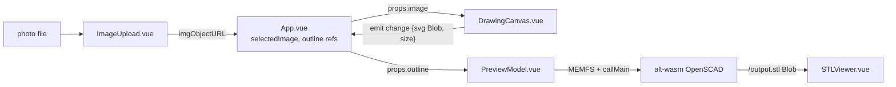

# Repository Guidelines

## Project Overview

Gensert ("Custom Gridfinity Insert Generator", `index.html`) is a client-side Vue 3 + Vite SPA that generates custom Gridfinity bin inserts. Workflow in `src/App.vue`: `ImageUpload` → `DrawingCanvas` (trace outline over photo → SVG) → `PreviewModel` (OpenSCAD WASM → `bin-outline.stl` via `STLViewer`). No backend; all compute in-browser.

## Architecture & Data Flow

- State: local `ref()` + props-down / `@change`-up. No Pinia/Vuex, no router, no DI.
- `DrawingCanvas.vue`: image underlay + 2 absolute SVG overlays (scale line, closed Catmull-Rom outline); `calcedScale = mm / px`; `watch([outlinePoints, outlineTension])` emits `{svg: Blob, size}`.
- `PreviewModel.vue:96-250`: fetches SCAD from `public/openscad/`, stages MEMFS (`FS.writeFile`), derives `gridx/y = ceil(size/42)+extra`, runs synchronous `callMain([... -D k=v, -o output.stl])` (blocks tab — UI warns), reads `/output.stl` → Blob URL.
- `STLViewer.vue`: injects `/viewstl/stl_viewer.min.js` via `<script>` in `onMounted`, instantiates `window.StlViewer`.
- Gotchas: fresh `WebAssembly.Memory(16384,16384)` per Generate click; `window.scadInstance` debug leak; `prepFS` uses un-awaited `forEach(async…)`; `scadResources` watcher double-fetches on mount.
- `src/lib/openscad-wasm/` is vendored but **unused** (no imports); active backend is `src/lib/alt-wasm/`. Do not edit vendored WASM/viewer assets.

## Key Directories

| Path | Purpose |
|---|---|
| `src/components/` | All UI: `ImageUpload.vue`, `DrawingCanvas.vue`, `PreviewModel.vue`, `STLViewer.vue` |
| `src/lib/alt-wasm/` | Active OpenSCAD WASM runtime (`openscad.js`, `.wasm`, `.d.ts`, `browserfs.min.js`) |
| `src/lib/openscad-wasm/` | Unused alternate WASM build — leave alone |
| `public/openscad/` | Gridfinity `.scad` sources + SVGs, fetched at runtime via `fetch()` (not bundled) |
| `public/viewstl/` | Vendored Three.js STL viewer (`stl_viewer.min.js`, `three.min.js`, controls) |
| `examples/` | 3 sample photos only, not fixtures |

## Development Commands

| Command | Purpose |
|---|---|
| `npm run dev` | Vite HMR dev server |
| `npm run build` | Production build → `dist/` (only verification available) |
| `npm run preview` | Serve built `dist/` |

No `test`, `lint`, `typecheck`, or `format` scripts. `npm install` with npm only.

## Code Conventions & Common Patterns

- Vue 3 SFC `<script setup>` (plain JS; sole TS is `STLViewer.vue lang="ts"`). Props via `defineProps`, events via `defineEmits(['change'])`.
- Styling: Tailwind v4 + daisyUI, CSS-first (`src/style.css` is just `@import "tailwindcss"; @plugin "daisyui";`). No `tailwind.config.*`.
- Import alias `@` → `/src` (`vite.config.js`). Auto-component registration via `unplugin-vue-components`.
- Async: raw `fetch` + `async/await`; no async library. OpenSCAD interaction via Emscripten `FS` (`writeFile`/`readFile`/`mkdir`) and `callMain(args)`.
- Error handling: ad-hoc (`print`/`printErr` callbacks, UI warning text). No shared error utility.
- Naming: PascalCase SFCs, camelCase refs (`selectedImage`, `outlinePoints`, `calcedScale`, `scadVariables`).

## Important Files

- Entry: `index.html` → `src/main.js` (`createApp(App).use(VueKonva).mount('#app')`) → `src/App.vue` (root orchestrator, `readyToGenerate` gate).
- `src/components/DrawingCanvas.vue` — scale/outline tracing + `createSVG()`.
- `src/components/PreviewModel.vue` — SCAD params (`scadVariables`), WASM driver, Generate/Download.
- `src/lib/alt-wasm/openscad.d.ts` — WASM contract (`InitOptions`, `OpenSCAD.callMain`, `FS`).
- `vite.config.js` — `vue()`, `tailwindcss()`, `Components()` plugins + `@` alias.
- `package.json` — sole manifest (`vue`, `vue-konva`/`konva`, `tailwindcss`, `daisyui`).

## Runtime/Tooling Preferences

- Runtime: Node (browser SPA via Vite 6, ESM `"type": "module"`). No Bun/Deno/Docker/CI.
- Package manager: **npm** (`package-lock.json`, `lockfileVersion: 3`). No yarn/pnpm/bun locks, no `engines`/`volta`/nvmrc pins.
- No lint/format/typecheck configs (no eslint, prettier, biome, tsconfig, `.editorconfig`, `.github/`). Editor: `Vue.volar` recommended (`.vscode/extensions.json`).
- `README.md` is stale Vite template boilerplate — not project docs; no CHANGELOG/CONTRIBUTING.

## Testing & QA

- No tests, no framework, no coverage, no CI gates. Zero `*.test.*`/`*.spec.*`, `test/`, `__tests__/`, `e2e/`, `fixtures/`.
- `public/openscad/gridfinity-rebuilt-bins-test.scad` is an OpenSCAD model asset, not a test.
- Verification: `npm run build` must pass. Manual smoke: upload photo → trace outline → Generate → STL previews/downloads.
